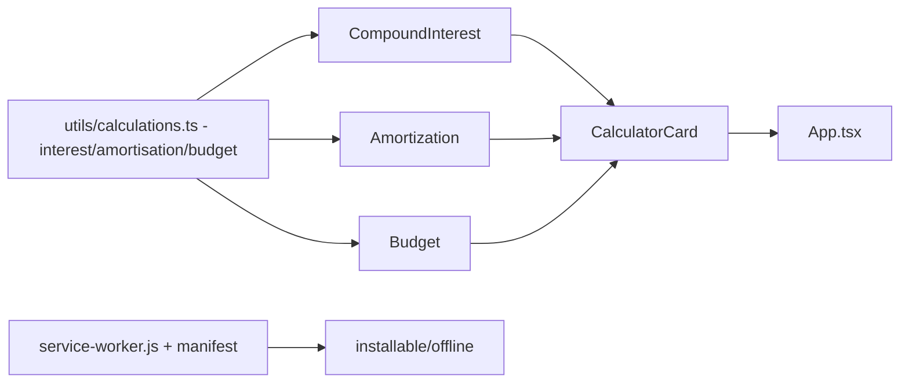

# calculadora-financeira-pwa

**English** · [Português (Brasil)](README.md)

     

## What it is

**An offline-first personal-finance calculators PWA**: three tools — **compound interest**, **amortisation** and **budget** — in a React 18 + TypeScript SPA that **installs as an app and works offline** (Service Worker + manifest in `public/`). The financial logic is pure and tested (`src/utils/calculations.ts`).

## Status

A working PWA (prototype); **7 tests passing** (calculations) with a confirmed production build (~48 kB gzip).

## Features

- **Compound interest** (`components/CompoundInterest.tsx`): initial deposit + monthly contributions + rate → projection.
- **Amortisation** (`components/Amortization.tsx`): instalments, balance and accrued interest.
- **Budget** (`components/Budget.tsx`): income/expenses over a period.
- **Pure calculations** (`utils/calculations.ts`): financial functions tested without a DOM (`calculations.test.ts`).
- **Installable/offline** (`public/manifest.json`, `public/service-worker.js`, `src/registerSW.ts`): 192/512 icons, app-shell cache.

## Architecture

A React SPA (Vite) with layers: pure logic in `utils/`, UI in `components/` (`CalculatorCard` as the frame), Service Worker registration in `main.tsx`/`registerSW.ts`.



## Stack

- React 18.3, TypeScript ~5.6, Tailwind
- Vite 5.4 (build), Vitest 2.1 (tests)

## Repository layout

```
calculadora-financeira-pwa/
├── src/
│   ├── components/          # CompoundInterest, Amortization, Budget, CalculatorCard
│   ├── utils/calculations.ts + calculations.test.ts
│   ├── registerSW.ts · main.tsx · App.tsx
├── public/                  # manifest.json, service-worker.js, icons 192/512
├── index.html · vite.config.ts
└── package.json
```

## Prerequisites and installation

Node.js ≥ 18.

```bash
npm install
```

## How to run

```bash
npm run dev        # dev server
npm run build      # production build
npm run preview    # serves the build (where the SW/PWA is exercised)
```

## Tests and quality

Real commands (verified by the agent):

```bash
npm test
# Test Files  1 passed (1) · Tests  7 passed (7)

npm run build
# ✓ built in ~1.3s
```

## Technical decisions and trade-offs

- **Hand-rolled Service Worker** (no vite-pwa plugin): full control and zero extra dependencies; the trade-off is manual caching.
- **Pure financial logic in `utils/`**: testable without rendering; the UI only presents.

## Known limitations and roadmap

- No scenario persistence (each calculation is ephemeral).
- Amortisation follows the default model (no configurable SAC/PRICE tables beyond the implemented default).

## Development process

An individual project by Kelvin Oliveira, built with orchestrated AI agents and reviewed by the author.

## License and author

MIT — Copyright (c) 2026 Kelvin Oliveira.

**Author**: [Kelvin Oliveira](https://github.com/KelvinOliveiraCode) · [Portfolio](https://kelvinoliveiracode.github.io/portfolio/)
