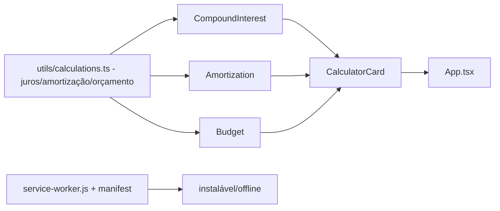

# calculadora-financeira-pwa

**English** · [Português (Brasil)](README.md)

     

## O que é

**PWA offline-first de calculadoras financeiras**: três ferramentas de controle pessoal — **juros compostos**, **amortização** e **orçamento** — numa SPA React 18 + TypeScript que **instala como app e funciona sem internet** (Service Worker + manifest em `public/`). A lógica financeira é pura e testada (`src/utils/calculations.ts`).

## Status

PWA funcional (protótipo); **7 testes passando** (calculations) e build de produção confirmado (~48 kB gzip).

## Funcionalidades

- **Juros compostos** (`components/CompoundInterest.tsx`): aporte inicial + aportes mensais + taxa → projeção.
- **Amortização** (`components/Amortization.tsx`): parcelas, saldo e juros acumulados.
- **Orçamento** (`components/Budget.tsx`): entradas/saídas por período.
- **Cálculos puros** (`utils/calculations.ts`): funções financeiras testadas sem DOM (`calculations.test.ts`).
- **Instalável/offline** (`public/manifest.json`, `public/service-worker.js`, `src/registerSW.ts`): ícones 192/512, cache do shell.

## Arquitetura

SPA React (Vite) com camadas: lógica pura em `utils/`, UI em `components/` (`CalculatorCard` como moldura), registro do Service Worker em `main.tsx`/`registerSW.ts`.



## Stack

- React 18.3, TypeScript ~5.6, Tailwind
- Vite 5.4 (build), Vitest 2.1 (testes)

## Estrutura do repositório

```
calculadora-financeira-pwa/
├── src/
│   ├── components/          # CompoundInterest, Amortization, Budget, CalculatorCard
│   ├── utils/calculations.ts + calculations.test.ts
│   ├── registerSW.ts · main.tsx · App.tsx
├── public/                  # manifest.json, service-worker.js, ícones 192/512
├── index.html · vite.config.ts
└── package.json
```

## Pré-requisitos e instalação

Node.js ≥ 18.

```bash
npm install
```

## Como executar

```bash
npm run dev        # dev server
npm run build      # build de produção
npm run preview    # serve o build (aí o SW/PWA é exercitado)
```

## Testes e qualidade

Comandos reais (verificados pelo agente):

```bash
npm test
# Test Files  1 passed (1) · Tests  7 passed (7)

npm run build
# ✓ built in ~1.3s
```

## Decisões técnicas e trade-offs

- **Service Worker à mão** (sem plugin vite-pwa): controle total e zero dependências extra; em troca, caching manual.
- **Lógica financeira pura em `utils/`**: testável sem renderizar; a UI só apresenta.

## Limitações conhecidas e roadmap

- Sem persistência de cenários (cada cálculo é efêmero).
- Amortização segue o modelo padrão (sem tabelas SAC/PRICE configuráveis além do padrão implementado).

## Processo de desenvolvimento

Projeto individual de Kelvin Oliveira, construído com agentes de IA orquestrados e revisado pelo autor.

## Licença e autor

MIT — Copyright (c) 2026 Kelvin Oliveira.

**Autor**: [Kelvin Oliveira](https://github.com/KelvinOliveiraCode) · [Portfólio](https://kelvinoliveiracode.github.io/portfolio/)
